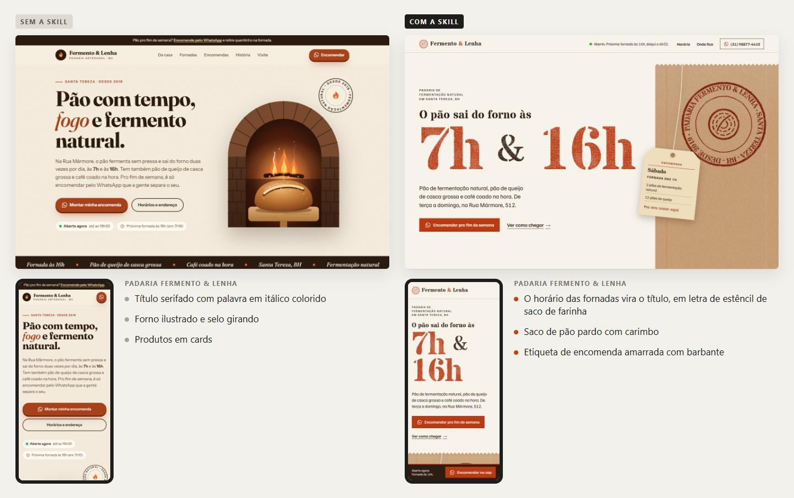
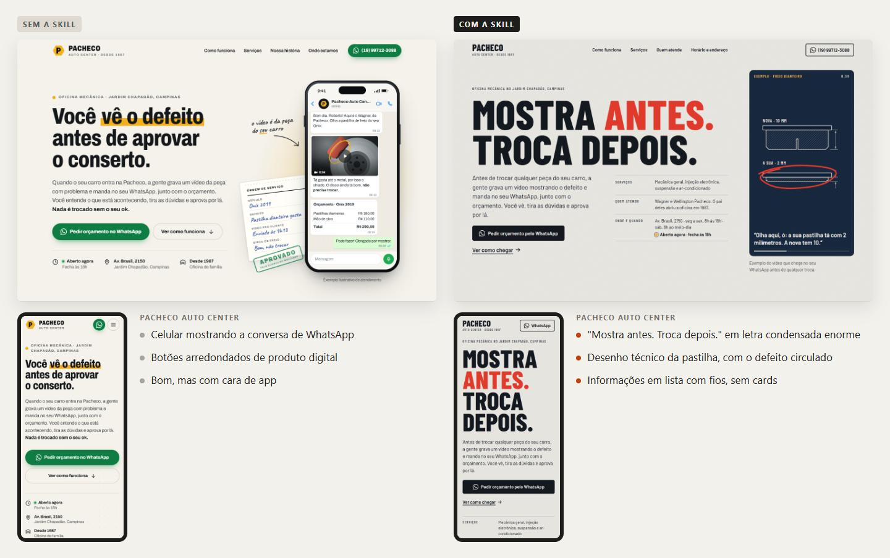
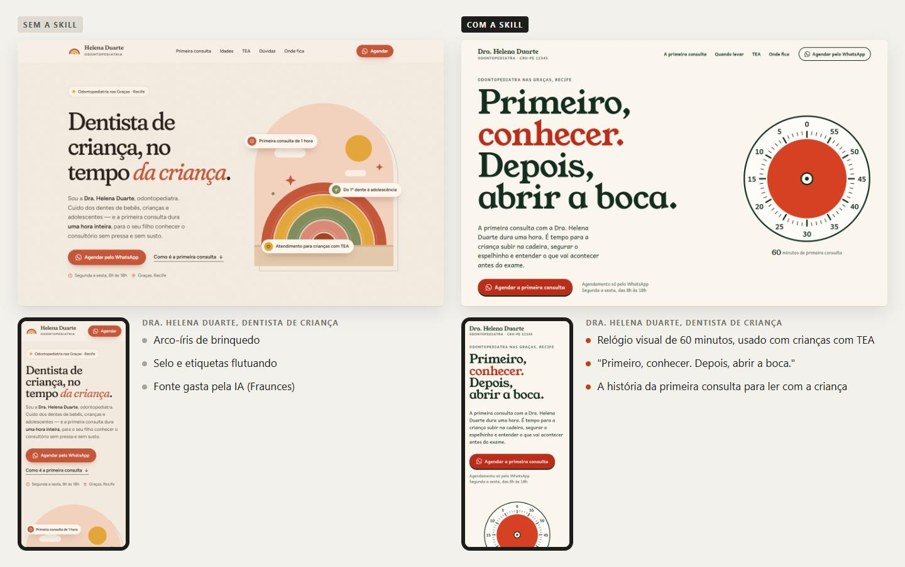
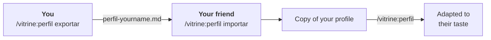

[Português](README.md) · **English**

# Vitrine

**Your website is your shop window. It should look like you.**

*Vitrine* is Portuguese for shop window. A skill for **Claude Code** that builds websites, landing pages and portfolios with personality. It starts by finding out what makes you, or your client, different, and puts that into the visuals, the copy and the details.

> Made in Brazil: it writes in Brazilian Portuguese, and the command names are in Portuguese too.



<sub>Same request, same AI model. Left: without the skill ("Sem a skill"). Right: with it ("Com a skill").</sub>

## What makes it different

- **Every site starts from the person behind it.** The skill looks for what only that business or person has (the bakery's bread bag, the repair shop's work order, a designer's sketchbook) and builds the visual concept from it.
- **Different, but recognizable.** It avoids the industry's clichés without losing its cues: a clinic still looks like a clinic.
- **Nothing made up.** Testimonials, prices, awards or photos the client didn't provide are marked `[[like this]]`, or the skill says exactly which photo to take.
- **Checks before delivering.** It takes desktop and mobile screenshots, looks for clipped text, tiny type and lines that vanish, and fixes them.
- **Fits a freelancer's workflow.** A briefing message for the client's WhatsApp, 2 or 3 concepts as a PDF for them to pick, and a site in plain HTML that runs on any host.
- **Built for local businesses.** WhatsApp button, opening hours, address, Google, and the advertising rules of Brazilian professional boards (CFO, CFM, OAB).
- **Precise tweaks.** On the review page you tap a heading, button or section in the screenshot and write what to change there. The skill knows exactly which element to edit.
- **Learns your taste.** You approve or reject sites on a review page, and the skill keeps what works for you for the next jobs.

## Installation

In Claude Code, type:

```
/plugin install vitrine --marketplace zjeanero/vitrine-skill
```

Close and reopen Claude Code. The first time, Vitrine opens a welcome page in your browser. Then type **`/vitrine:inicio`** (*início* = start): it checks whether anything is missing on your computer and walks you through the steps.

<details>
<summary><b>First time? What you need</b></summary>

- **Node 22 or newer.** In a terminal, type `node --version`. If you don't have it, download the LTS version from [nodejs.org](https://nodejs.org).
- **Chrome or Edge.** Windows already ships with Edge.
</details>

<details>
<summary><b>For professionals</b></summary>

| To | Command |
|---|---|
| Install from the terminal | `claude plugin install vitrine --marketplace zjeanero/vitrine-skill` |
| Install for one project only | add `--scope project` or `--scope local` |
| Update | `claude plugin update vitrine@vitrine-skill` |
| Turn off / remove | `claude plugin disable vitrine@vitrine-skill` / `claude plugin uninstall vitrine@vitrine-skill` |
| Install without GitHub | from the .zip package (see [Your profile and sharing](#your-profile-and-sharing)) |
| Older Claude Code | `/plugin marketplace add zjeanero/vitrine-skill`, then `/plugin install vitrine@vitrine-skill` |
</details>

<details>
<summary><b>Trouble?</b></summary>

| Problem | Fix |
|---|---|
| `/vitrine:inicio` doesn't show up | Close and reopen Claude Code |
| Error about `--marketplace` | Run `claude update` |
| Repository not found | Check that you typed `zjeanero/vitrine-skill` correctly |
| "node is not recognized" | Install Node LTS from [nodejs.org](https://nodejs.org) and reopen the terminal |
| "Chrome/Edge não encontrado" (not found) | Install Google Chrome |
</details>

## How to use it

| | You type | You get |
|:-:|---|---|
| **0** | `/vitrine:perfil` *(once; profile)* | Claude learns your taste from links or screenshots of references |
| **1** | `/vitrine:briefing Padaria do Sérgio` | A ready-to-send WhatsApp message for the client, with questions and a photo list |
| **2** | Paste the reply, or `/vitrine:aproveitar <link>` *(reuse)* | Everything organized: what's confirmed and what's missing |
| **3** | `/vitrine:conceitos` *(concepts)* | 2 or 3 visual directions (HTML + PDF) for the client to pick |
| **4** | `/vitrine:site` | The finished site, checked on desktop and mobile |
| **5** | `/vitrine:avaliar` *(evaluate)* | A page to approve or reject the sites and pin the exact spot of each tweak on the screenshot. The skill learns your taste from it |
| **+** | `/vitrine:revisar <link>` *(review)* | An audit of any website: what looks AI-made and what's missing |

The commands are just shortcuts: plain language works too.

## Why not just a prompt?

A plain prompt already gets the technical basics right. The skill takes care of the rest:

| | Plain prompt | With the skill |
|---|---|---|
| **Starting point** | The most likely layout: centered headline, cards, gradient | The objects and habits of the business become the concept |
| **Typography** | Trendy fonts (the same one in 2 of 3 tests) | A typeface chosen for the business, from verified fonts |
| **Content** | Makes up what's missing | Never makes things up: marks `[[like this]]` |
| **Checking** | Delivers without looking | Desktop and mobile screenshots, fixed before delivery |
| **Local business** | Generic | WhatsApp, opening hours, Google, professional advertising rules |
| **For the client** | Just the site | A WhatsApp briefing and 2 or 3 concepts to choose from |
| **Your taste** | Starts from scratch every time | A saved profile with your references and stack that learns from every site you approve |

<details>
<summary><b>More examples and how it was tested</b></summary>





Three fictional businesses got the same request, once with the skill and once without. On the automatic checks (WhatsApp, mobile, local SEO, nothing made up), the score was 100% with the skill and 95% without. The biggest difference showed in the visuals, the fonts and the made-up content. The tests are in [`avaliacao/`](avaliacao/).
</details>

## Your profile and sharing

The skill is the same for everyone. Your taste lives in a **profile**, in `~/.claude/landing-page/`, which updates never erase.

- **Create or change it:** `/vitrine:perfil`
- **Send it to a friend:** `/vitrine:perfil exportar` (export) creates a file. They run `/vitrine:perfil importar <file>` (import) and adapt it to their taste. Their copy never touches yours.
- **Send it without GitHub:** `pwsh ferramentas/empacotar.ps1 -ComPerfil -Nome <your-name>` builds a .zip with the skill and your profile. They install it with `/plugin install vitrine --marketplace <folder>/skill`.

<details>
<summary><b>Detailed steps</b></summary>



1. **You** run `/vitrine:perfil exportar`. You get a single file, like `perfil-jean.md`, without the client log. Send it by WhatsApp, email or Drive.
2. **They** install the skill and run `/vitrine:perfil importar perfil-jean.md`. They can drag the file into the window instead of typing the path.
3. **They adapt it in plain language:** `/vitrine:perfil I use Astro`, `/vitrine:perfil add https://…`.

**If they already have a profile,** Claude asks before touching anything: **merge** (your references join theirs), **replace** (theirs is kept in `antigo-<date>/`) or **cancel**.

**With the .zip:** they unzip it into a folder they won't delete and point to the `skill` folder inside. The package's `LEIA-ME.txt` has the steps. Every new version means sending a new .zip. Anyone who installed from GitHub just runs `claude plugin update vitrine@vitrine-skill`.
</details>

## Quick questions

<details>
<summary><b>Do I need to know how to code?</b></summary>

No. You talk to Claude, and it delivers a finished folder. Knowing HTML only helps with fine-tuning.
</details>

<details>
<summary><b>What technology do the sites use?</b></summary>

Plain HTML, CSS and JavaScript (plus PHP when needed), which run on any host. If you use another stack (Astro, Next.js, WordPress…), say so in `/vitrine:perfil`.
</details>

<details>
<summary><b>Does it work for portfolios?</b></summary>

Yes. For portfolios and studio sites, Vitrine uses real motion (smooth scrolling, headlines that rise line by line, a horizontal project gallery, and 3D when the concept calls for it), always keeping the content visible if something fails. On local business sites it holds back: visitors want the opening hours and the WhatsApp button.
</details>

<details>
<summary><b>Can the client change prices and hours on their own?</b></summary>

Yes. Prices, menus, opening hours and notices can live in a Google Sheet the client edits, and the site picks up the change within minutes. The design stays in the code, and the content written in the HTML keeps the site working if the sheet fails.
</details>

<details>
<summary><b>Where do the files go?</b></summary>

Each client gets a folder with `briefing.md`, `material/` (the client's photos), `conceitos/`, `site/` and `NOTAS.md` (pending items and a photo list).
</details>

<details>
<summary><b>Does the skill generate photos?</b></summary>

No, on purpose: a made-up photo of a business misleads the people who go there. It uses the client's real photos with art direction and drawings made in code. Where a photo is missing, it describes exactly which shot to take.
</details>

<details>
<summary><b>How much of my plan does it use?</b></summary>

About 650 tokens per session, and roughly 7k each time the skill is used. A complete site with visual review takes around 200k to 300k tokens.
</details>

<details>
<summary><b>For maintainers</b></summary>

```
.claude-plugin/marketplace.json     catalog for one-command install
plugins/vitrine/                    the plugin: commands/ (the /vitrine:*) and skills/landing-page/ (the skill)
perfis/modelo/                      empty profile template
avaliacao/                          with/without-skill tests
ferramentas/empacotar.ps1           builds the .zip to share without GitHub
docs/img/                           images for this README
```

**To release a version:**
1. Bump `version` in `plugins/vitrine/.claude-plugin/plugin.json`.
2. Run `claude plugin validate .`.
3. Push, then run `claude plugin update vitrine@vitrine-skill`.
</details>

## License

[MIT](LICENSE): use it, change it and build sites for your clients freely. Just keep the license file with it.
