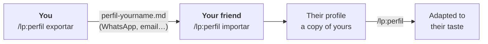

[Português](README.md) · **English**

# lp: landing pages that don't look AI-generated

A **Claude Code** plugin that builds landing pages for freelance clients and local businesses. Each page grows out of the client's own world (the bakery's paper bread bag, the auto shop's work order) instead of a template.

> The skill is built for Brazilian small businesses. It writes in Brazilian Portuguese and knows local needs like WhatsApp ordering, Google listings and professional advertising rules. The command names are in Portuguese too, and the table below translates them.


<sub>Same request, same AI model. Left: without the skill ("Sem a skill"). Right: with it ("Com a skill").</sub>

---

## Get started in 1 minute

**1. Install.** In Claude Code, type:

```
/plugin install lp --marketplace zjeanero/claude-skills
```

**2. Restart Claude Code and type:**

```
/lp:inicio
```

That's it: Claude walks you through the steps and asks where you'd like to start.

---

## From request to website in 5 steps

| | You type | You get |
|:-:|---|---|
| **0** | `/lp:perfil` *(once)* | Claude learns your taste. Send links or screenshots of sites you admire. |
| **1** | `/lp:briefing Padaria do Sérgio` | A ready-to-send WhatsApp message for your client, with the questions and a photo shot list. |
| **2** | Paste the client's reply, or `/lp:aproveitar <link>` | Everything organized: what's confirmed and what's still missing. |
| **3** | `/lp:conceitos` | 2 or 3 visual directions, in HTML and PDF, for the client to choose from. |
| **4** | `/lp:site` | The finished site, checked on desktop and mobile, with a list of what's still pending. |

Need changes later? Just ask: *"make the headline bigger"*, *"the client sent the photos, swap out the placeholders"*.

> Commands are just shortcuts. Plain language works too: *"make a landing page for Marcos's barbershop in Contagem"*.

---

## Before and after


<sub>All three businesses are fictional and were used to test the skill. Both versions of each one got exactly the same request.</sub>

---

## The skill vs. a plain prompt

You can ask any AI for a landing page directly, and the result isn't bad: in our tests, Claude without the skill got almost all the technical basics right. The difference is in what a prompt alone doesn't guarantee: **identity, honesty and finish.**

| | Plain prompt | With the skill |
|---|---|---|
| **Starting point** | The most likely option: centered headline, icon cards, gradient. That's why everything looks alike. | An **excavation** of the client's world (objects, words, rituals) that becomes the concept: the bread bag, the work order. |
| **Typography** | Trendy fonts. In our tests, the same font (Fraunces) showed up in 2 of 3 sites. | A typeface with personality, chosen for the spirit of the business, from verified, licensed fonts tested for Portuguese accents. |
| **Content** | Fills gaps by making things up: a "neighborhood approved" badge, services nobody mentioned. | **Never makes things up.** Missing info is marked `[[like this]]` and goes on the pending list. |
| **Photos** | Stock photos, generic illustrations, or nothing. | Real photos with art direction. Where a photo is missing, it leaves a directed placeholder and a **shot list** for the client. |
| **Checking** | Delivers without looking at the result. In our tests, one site overflowed sideways on mobile. | Takes **desktop and mobile screenshots**, looks for problems (horizontal scroll, fonts that didn't load, hidden WhatsApp button) and fixes them before delivering. |
| **Local business** | Generic. | WhatsApp with a pre-filled message, opening hours, Google structured data, professional advertising rules, privacy law, lightweight pages for 4G. |
| **Working with the client** | Code only. | Briefing message, reuse of the client's existing site/Instagram/Google content, concept presentation for approval and delivery notes. |
| **Your taste** | Starts from scratch every conversation. | A saved **profile** with your references, stack and rules, plus a log that avoids repeating fonts and colors across clients. |
| **Consistency** | Depends on how you write the prompt that day. | The same method every time, with short commands. |
| **Cost** | Fewer tokens. | A bit more per site because of the visual review, which is already optimized to look at few images. |

<details>
<summary><b>What's inside the skill</b></summary>

| Piece | What it does |
|---|---|
| **7-step method** | Briefing → excavation → concept → copy → build → visual review → delivery |
| **Anti-pattern catalog** | Dozens of "AI look" tells in layout, color, typography, copy and motion, each with what to do instead. Includes the "distinctive" fonts AI has already worn out |
| **Typography guide** | How to pick type for the spirit of the business, verified fonts (Google Fonts, Fontshare) grouped by style, scale and loading |
| **Local-business checklist** | WhatsApp, phone, map, opening hours, local SEO, professional council rules, privacy, performance and accessibility |
| **Screenshot script** | Captures the page on desktop and mobile, builds a contact sheet and an error report. Needs nothing but Node and Chrome |
| **Step guides** | Briefing message, content reuse, concept presentation, audit of an existing site |
| **Profile and log** | Your saved taste, exportable to other people, and your project history |
| **7 commands** | Shortcuts for each step (`/lp:inicio`, `/lp:site`…) |
</details>

<details>
<summary><b>How the skill was tested</b></summary>

Three fictional businesses (a bakery, an auto repair shop and a pediatric dentist) got **the same request** twice: once with the skill and once without. All 6 sites went through the same automatic checks: correct WhatsApp link, nothing overflowing on mobile, no errors, local SEO, heading font, nothing made up and dental advertising rules.

- **Automatic checks:** 100% with the skill, 95% without. The model alone is already strong on the technical basics.
- **Where the difference showed:** in the visuals (images above), the worn-out fonts, the made-up content and the mobile finish.

The test cases and grading tools are in [`avaliacao/`](avaliacao/).
</details>

---

## Your version of the skill

The skill is the same for everyone. What changes from person to person lives in a **profile** saved on your computer:

| | Ships with the plugin (same for everyone) | Lives in your profile (yours only) |
|---|---|---|
| **What** | The method, the "AI look" anti-patterns, typography, local-business checklist, commands | Your references, your stack, your taste, your projects |
| **Where** | Installed by `/plugin install` | `~/.claude/landing-page/` |
| **Updates** | Arrive with `claude plugin update` | Never erased by updates |

**To create yours, type `/lp:perfil`.** Claude asks who you build sites for and which stack you use, then asks for 3 to 5 references: links, screenshots, even packaging or a magazine you like. It analyzes them and saves your profile. From then on, **your profile wins** on taste and stack.

The skill ships with two neutral examples that show the format of a good reference analysis, and your references take their place. An empty profile template with instructions lives in [`perfis/modelo/`](perfis/modelo/).

To pass the skill on **with your taste** to someone else, see the next section.

---

## Share with a friend

There are two parts: the **skill**, which is the same for everyone, and **your profile**, which holds your taste. Your friend installs the skill and gets your profile from you as a file.



### You (sending)

**1.** In Claude Code, type (`exportar` = export):

```
/lp:perfil exportar
```

**2.** Claude creates **a single file**, for example `perfil-jean.md`, with your preferences and references.
- Your client log is **not included**, because it's private.
- Before saving, Claude checks that nothing personal is left in the file, like a client's name or phone number.

**3.** Send the file to your friend however you like: WhatsApp, email, Drive.

### Your friend (receiving)

**1.** They install the skill, if they haven't yet:

```
/plugin install lp --marketplace zjeanero/claude-skills
```

**2.** They save the file anywhere and type (`importar` = import):

```
/lp:perfil importar perfil-jean.md
```

> Tip: instead of typing the path, you can drag the file into the Claude Code window.

**3.** Done: your taste becomes their starting point.

### They can change anything

The imported profile is **a copy**. They adapt it in plain language:

```
/lp:perfil add https://a-site-i-like.com
/lp:perfil I work with Astro and host on Vercel
/lp:perfil never use carousels
```

None of this changes **your** profile: everyone has their own, on their own computer.

### What if they already have a profile?

Claude asks before touching anything:

| Option | What happens |
|---|---|
| **Merge** | Your references are added to theirs; their preferences stay |
| **Replace** | Their profile is kept in an `antigo-<date>/` folder, and yours takes its place |
| **Cancel** | Nothing changes |

### Common questions

- **Do they need access to your GitHub?** No. The exported file is enough.
- **Can a "Replace" be undone?** Yes. The old profile stays in `antigo-<date>/`; just ask *"bring back my old profile"*.
- **Can I send only my references?** Yes. Ask *"export only my references"*.
- **What if I change my profile later?** Their copy doesn't update by itself. To send the new version, export again.

### No GitHub access? Send everything in a .zip

While the repository isn't public, you can send **the skill and your profile in a single file**.

**1. You build the package.** The easiest way is to ask Claude: *"build the skill package with my profile to send to my friend"*. Or run this in PowerShell, from the repository folder:

```
pwsh ferramentas/empacotar.ps1 -ComPerfil -Nome jean
```

You get `lp-skill-<version>.zip` on your Desktop, with the skill, your profile (without the client log) and a `LEIA-ME.txt` with the steps (in Portuguese).

**2. They install it.** They unzip it into a folder they won't delete and, in Claude Code, point to the `skill` folder inside:

```
/plugin install lp --marketplace C:\Users\THEIR-NAME\Documents\lp-skill-0.6.1\skill
```

**3. They import your profile,** if they want: `/lp:perfil importar perfil-jean.md`. From there it works as described above.

> Every new version of the skill means sending a new .zip. Once the repository is public, the GitHub command handles everything, and updates arrive with `claude plugin update`.

---

## All commands

| Command | Means | What it does |
|---|---|---|
| `/lp:inicio` | start | Shows the step-by-step and where to begin |
| `/lp:perfil` | profile | Records your taste: references (links or screenshots), stack, what to avoid |
| `/lp:briefing` | briefing | Writes the message for your client: questions and photo list |
| `/lp:aproveitar` | reuse | Pulls content from the client's website, Instagram or Google listing |
| `/lp:conceitos` | concepts | Builds visual directions for the client to choose from (HTML + PDF) |
| `/lp:site` | site | Builds the website |
| `/lp:revisar` | review | Audits any website: what looks AI-made and what's missing |

---

## Quick questions

<details>
<summary><b>Do I need to know how to code?</b></summary>

No. You talk to Claude, and it writes the code and delivers a finished folder. Knowing HTML helps with fine-tuning, but it isn't required.
</details>

<details>
<summary><b>What technology do the sites use?</b></summary>

By default, plain HTML, CSS and JavaScript, which run on any host, plus PHP when needed. If you work with another stack (Astro, Next.js, WordPress…), say so in `/lp:perfil` and the skill will use it.
</details>

<details>
<summary><b>Where do the files go?</b></summary>

Each client gets a folder:

```
padaria-do-sergio/
├── briefing.md      what we know about the business (each fact with its source)
├── material/        photos, screenshots and logo the client sent
├── conceitos/       the visual directions (index.html + pagina.pdf)
├── site/            the finished website
└── NOTAS.md         pending items, photo list, how to publish
```

Your profile lives in `~/.claude/landing-page/` and survives skill updates.
</details>

<details>
<summary><b>Does the skill generate photos?</b></summary>

No, on purpose: a made-up photo of a business misleads the people who go there. The skill uses the client's real photos with art direction (duotone, cut-outs, grain) and drawings made in code. Where a photo is still missing, it leaves a placeholder describing exactly which shot to take.
</details>

<details>
<summary><b>How much of my plan does it use?</b></summary>

About 650 tokens per session, so Claude knows the skill exists, and roughly 7k each time it's used. In testing, a complete site with visual review took 240k to 330k tokens; the current version looks at fewer images during review and should use less.
</details>

<details>
<summary><b>Do I need anything installed?</b></summary>

Node 22 or newer and Chrome or Edge, which are used to take the review screenshots. If your browser lives somewhere unusual, set the `CHROME_PATH` environment variable.
</details>

<details>
<summary><b>How do I update, disable or remove it?</b></summary>

```
claude plugin update lp@claude-skills      update (then restart Claude Code)
claude plugin disable lp@claude-skills     turn off without removing
claude plugin uninstall lp@claude-skills   remove
```
</details>

---

<details>
<summary><b>For maintainers</b></summary>

```
.claude-plugin/marketplace.json     catalog that enables one-command install
plugins/landing-page/               the "lp" plugin
├── .claude-plugin/plugin.json      name, version, description
├── commands/                       the /lp:* commands
└── skills/landing-page/            the skill (in Portuguese)
    ├── SKILL.md                    usage modes + 7-step process
    ├── references/                 anti-patterns, typography, local business, briefing, concepts…
    └── scripts/screenshot.mjs      screenshots + contact sheet + report (no dependencies)
perfis/modelo/                      empty profile template
avaliacao/                          with/without-skill tests (cases, automatic grading)
ferramentas/empacotar.ps1           builds the skill (and profile) .zip to share without GitHub
docs/img/                           images for this README
```

**To release a version:**
1. Bump `version` in `plugins/landing-page/.claude-plugin/plugin.json`.
2. Run `claude plugin validate .`.
3. Push, then run `claude plugin update lp@claude-skills`.

The with/without-skill tests live in `avaliacao/`.
</details>
