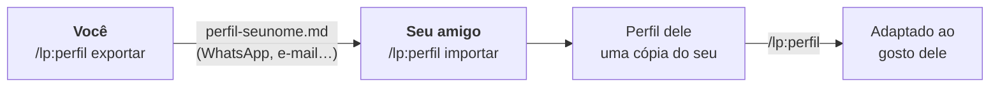

**Português** · [English](README.en.md)

# lp: landing pages que não parecem feitas por IA

Um plugin para o **Claude Code** que cria landing pages para clientes de freela e negócios locais. Cada página nasce do mundo do próprio cliente, como o saco de pão da padaria ou a ordem de serviço da oficina, e não de um template.


<sub>Mesmo pedido, mesmo modelo de IA. À esquerda, sem a skill; à direita, com ela.</sub>

---

## Instalação

No Claude Code, digite:

```
/plugin install lp --marketplace zjeanero/claude-skills
```

Feche e abra o Claude Code e digite **`/lp:inicio`**. Ele confere se falta algo no seu computador e mostra o passo a passo.

<details>
<summary><b>Primeira vez? O que precisa ter</b></summary>

- **Node 22 ou mais novo.** No terminal, digite `node --version`. Se não tiver, baixe a versão LTS em [nodejs.org](https://nodejs.org).
- **Chrome ou Edge.** O Windows já vem com o Edge.
</details>

<details>
<summary><b>Para profissionais</b></summary>

| Para | Comando |
|---|---|
| Instalar pelo terminal | `claude plugin install lp --marketplace zjeanero/claude-skills` |
| Instalar só num projeto | acrescente `--scope project` ou `--scope local` |
| Atualizar | `claude plugin update lp@claude-skills` |
| Desligar / remover | `claude plugin disable lp@claude-skills` / `claude plugin uninstall lp@claude-skills` |
| Instalar sem GitHub | a partir do pacote .zip (veja [Passar para um amigo](#passar-para-um-amigo)) |
| Claude Code antigo | `/plugin marketplace add zjeanero/claude-skills` e depois `/plugin install lp@claude-skills` |
</details>

<details>
<summary><b>Deu problema?</b></summary>

| Problema | Solução |
|---|---|
| `/lp:inicio` não aparece | Feche e abra o Claude Code |
| Erro com `--marketplace` | Rode `claude update` |
| Não encontrou o repositório | Ainda é privado: peça o pacote .zip |
| "node não é reconhecido" | Instale o Node LTS em [nodejs.org](https://nodejs.org) e reabra o terminal |
| "Chrome/Edge não encontrado" | Instale o Google Chrome |
</details>

---

## Do pedido ao site, em 5 passos

| | Você digita | Você recebe |
|:-:|---|---|
| **0** | `/lp:perfil` *(uma vez só)* | O Claude aprende o seu gosto. Mande links ou prints de sites que você admira. |
| **1** | `/lp:briefing Padaria do Sérgio` | Uma mensagem pronta para mandar no WhatsApp do cliente, com as perguntas e a lista de fotos. |
| **2** | Cole a resposta do cliente, ou `/lp:aproveitar <link>` | Tudo organizado: o que já é fato e o que ainda falta. |
| **3** | `/lp:conceitos` | 2 ou 3 caminhos visuais, em HTML e PDF, para o cliente escolher. |
| **4** | `/lp:site` | O site pronto, conferido no computador e no celular, com a lista do que ficou pendente. |

Para ajustar depois, é só pedir: *"aumenta o título"*, *"o cliente mandou as fotos, troca as pendentes"*.

> Os comandos são só atalhos. Também funciona falando normalmente: *"faz uma landing page pra barbearia do Marcos em Contagem"*.

---

## Antes e depois


<sub>Os três negócios são fictícios e foram usados nos testes da skill. As duas versões de cada um receberam exatamente o mesmo pedido.</sub>

---

## Skill × prompt direto na IA

Dá para pedir uma landing page direto para qualquer IA, e o resultado nem é ruim: nos nossos testes, o Claude sem a skill acertou quase todo o básico técnico. A diferença está no que um prompt sozinho não garante: **identidade, honestidade e acabamento.**

| | Prompt direto | Com a skill |
|---|---|---|
| **Ponto de partida** | A opção mais provável: título centralizado, cards com ícone, gradiente. Por isso tudo sai parecido. | Uma **escavação** do mundo do cliente (objetos, palavras, rituais), que vira o conceito. O saco de pão, a ordem de serviço. |
| **Tipografia** | As fontes da moda. Nos testes, a mesma fonte (Fraunces) apareceu em 2 de 3 sites. | Uma letra com personalidade, escolhida pelo espírito do negócio, a partir de fontes verificadas com licença e teste de acentos (ã, ç). |
| **Conteúdo** | Preenche o que falta inventando: selo "Aprovado pelo bairro", serviços que ninguém informou. | **Nunca inventa.** O que falta aparece marcado `[[assim]]` e vai para a lista de pendências. |
| **Fotos** | Banco de imagens, ilustração genérica, ou nada. | Fotos reais com tratamento. Onde falta foto, deixa um espaço dirigido e a **lista de fotos** para o cliente tirar. |
| **Conferência** | Entrega sem olhar o resultado. Nos testes, um site vazava para o lado no celular. | Tira **prints no computador e no celular**, procura erro (rolagem lateral, fonte que não carregou, WhatsApp escondido) e corrige antes de entregar. |
| **Negócio local** | Genérico. | WhatsApp com mensagem pronta, horários, Google (dados estruturados), regras de publicidade (CFO, CFM, OAB), LGPD, página leve no 4G. |
| **Trabalho com o cliente** | Só o código. | Mensagem de briefing, aproveitamento do site/Instagram/Google que ele já tem, apresentação de conceitos para aprovar e notas de entrega. |
| **Seu gosto** | Começa do zero a cada conversa. | Um **perfil** salvo com as suas referências, a sua stack e as suas regras, e um registro que evita repetir fontes e cores entre clientes. |
| **Consistência** | Depende de como você escreve o prompt naquele dia. | O mesmo método toda vez, com comandos curtos. |
| **Custo** | Menos tokens. | Um pouco mais por site, por causa da revisão visual, que já foi otimizada para olhar poucas imagens. |

<details>
<summary><b>O que tem dentro da skill</b></summary>

| Peça | O que faz |
|---|---|
| **Método em 7 etapas** | Briefing → escavação → conceito → texto → construção → revisão visual → entrega |
| **Catálogo de anti-padrões** | Dezenas de sinais de "cara de IA" em layout, cores, tipografia, texto e animação, cada um com o que fazer no lugar. Inclui as fontes "diferentes" que a IA já gastou |
| **Guia de tipografia** | Como escolher a letra pelo espírito do negócio, fontes verificadas (Google Fonts, Fontshare) organizadas por estilo, escala e carregamento |
| **Checklist de negócio local** | WhatsApp, telefone, mapa, horários, SEO local, regras de conselhos profissionais, LGPD, desempenho e acessibilidade |
| **Script de prints** | Fotografa a página no computador e no celular, gera uma folha de contato e um relatório de erros. Não precisa instalar nada além de Node e Chrome |
| **Guias de cada etapa** | Mensagem de briefing, aproveitamento de conteúdo, apresentação de conceitos, diagnóstico de site existente |
| **Perfil e registro** | O seu gosto salvo, exportável para outras pessoas, e o histórico de projetos |
| **7 comandos** | Atalhos para cada etapa (`/lp:inicio`, `/lp:site`…) |
</details>

<details>
<summary><b>Como a skill foi testada</b></summary>

Três negócios fictícios (uma padaria, uma oficina mecânica e uma dentista de criança) receberam **o mesmo pedido** duas vezes: uma com a skill e outra sem. Os 6 sites passaram pelos mesmos critérios automáticos: link de WhatsApp certo, nada vazando no celular, sem erros, SEO local, fonte do título, nada inventado e regras do CFO.

- **Critérios automáticos:** 100% com a skill, 95% sem. O modelo sozinho já é forte no básico técnico.
- **Onde a diferença apareceu:** no visual (as imagens acima), nas fontes gastas, no conteúdo inventado e no acabamento no celular.

Os casos de teste e as ferramentas de correção estão em [`avaliacao/`](avaliacao/).
</details>

---

## A sua versão da skill

A skill é a mesma para todo mundo. O que muda de pessoa para pessoa fica num **perfil**, salvo no seu computador:

| | Vem com o plugin (igual para todos) | Fica no seu perfil (só seu) |
|---|---|---|
| **O quê** | O método, os anti-padrões de "cara de IA", tipografia, checklist de negócio local, comandos | As suas referências, a sua stack, o seu gosto, os seus projetos |
| **Onde** | Instalado pelo `/plugin install` | `~/.claude/landing-page/` |
| **Atualizações** | Chegam com `claude plugin update` | Nunca são apagadas pelas atualizações |

**Para criar o seu, digite `/lp:perfil`.** O Claude pergunta para quem você faz sites e qual stack você usa, e pede de 3 a 5 referências: links, prints ou até uma embalagem ou revista de que você goste. Ele analisa tudo e guarda. Daí em diante, em gosto e stack, **o seu perfil manda**.

A skill traz dois exemplos neutros que mostram o formato de uma boa análise de referência, e as suas referências tomam o lugar deles. Um perfil-modelo vazio, com instruções, está em [`perfis/modelo/`](perfis/modelo/).

Para passar a skill **com o seu gosto** para outra pessoa, veja a seção seguinte.

---

## Passar para um amigo

São duas partes: a **skill**, igual para todos, e o **seu perfil**, com o seu gosto. O seu amigo instala a skill e recebe o perfil de você num arquivo.



### Você, que manda

**1.** No Claude Code, digite:

```
/lp:perfil exportar
```

**2.** O Claude cria **um arquivo só**, por exemplo `perfil-jean.md`, com as suas preferências e referências.
- O seu registro de clientes **não vai junto**, porque é privado.
- Antes de salvar, o Claude confere se não ficou nada pessoal no arquivo, como nome ou telefone de cliente.

**3.** Mande o arquivo para o seu amigo do jeito que preferir: WhatsApp, e-mail, Drive.

### Seu amigo, que recebe

**1.** Ele instala a skill, se ainda não tiver:

```
/plugin install lp --marketplace zjeanero/claude-skills
```

**2.** Ele salva o arquivo recebido em qualquer pasta e digita:

```
/lp:perfil importar perfil-jean.md
```

> Dica: em vez de digitar o caminho, dá para arrastar o arquivo para a janela do Claude Code.

**3.** Pronto: o seu gosto vira o ponto de partida dele.

### Ele pode mudar à vontade

O perfil importado é **uma cópia**. Ele adapta falando normalmente:

```
/lp:perfil adiciona https://um-site-que-eu-gosto.com
/lp:perfil eu trabalho com Astro e hospedo na Vercel
/lp:perfil nunca use carrossel
```

Nada disso muda o **seu** perfil: cada um tem o seu, no próprio computador.

### E se ele já tiver um perfil?

O Claude pergunta antes de mexer em qualquer coisa:

| Opção | O que acontece |
|---|---|
| **Juntar** | As suas referências entram junto com as dele; as preferências dele continuam |
| **Substituir** | O perfil dele fica guardado numa pasta `antigo-<data>/`, e o seu entra no lugar |
| **Cancelar** | Nada muda |

### Dúvidas comuns

- **Ele precisa de acesso ao seu GitHub?** Não. O arquivo exportado basta.
- **Dá para desfazer um "Substituir"?** Sim. O perfil antigo fica em `antigo-<data>/`; é só pedir *"volta o meu perfil antigo"*.
- **Posso mandar só as referências?** Pode. Peça *"exporta só as minhas referências"*.
- **E se eu mudar o meu perfil depois?** A cópia dele não muda sozinha. Se quiser mandar a versão nova, exporte de novo.

### Sem acesso ao GitHub? Mande tudo num .zip

Enquanto o repositório não é público, dá para mandar **a skill e o seu perfil num arquivo só**.

**1. Você gera o pacote.** O jeito mais fácil é pedir ao Claude: *"gera o pacote da skill com o meu perfil pra mandar pro meu amigo"*. Ou rode no PowerShell, na pasta do repositório:

```
pwsh ferramentas/empacotar.ps1 -ComPerfil -Nome jean
```

Aparece `lp-skill-<versão>.zip` na Área de Trabalho, com a skill, o seu perfil (sem o registro de clientes) e um `LEIA-ME.txt` com o passo a passo.

**2. Ele instala.** Descompacta numa pasta que não vá apagar e, no Claude Code, aponta para a pasta `skill` que veio dentro:

```
/plugin install lp --marketplace C:\Users\NOME-DELE\Documents\lp-skill-0.6.1\skill
```

**3. Ele importa o perfil,** se quiser: `/lp:perfil importar perfil-jean.md`. Daí em diante é igual ao que está acima.

> A cada versão nova da skill, é preciso mandar um .zip novo. Quando o repositório for público, o comando do GitHub resolve tudo, e as atualizações chegam com `claude plugin update`.

---

## Todos os comandos

| Comando | Para quê |
|---|---|
| `/lp:inicio` | Mostra o passo a passo e por onde começar |
| `/lp:perfil` | Registra o seu gosto: referências (links ou prints), stack, o que evitar |
| `/lp:briefing` | Gera a mensagem para o cliente: perguntas e lista de fotos |
| `/lp:aproveitar` | Puxa o conteúdo do site, Instagram ou Google do cliente |
| `/lp:conceitos` | Monta os caminhos visuais para o cliente escolher (HTML + PDF) |
| `/lp:site` | Faz o site |
| `/lp:revisar` | Faz o diagnóstico de qualquer site: o que tem cara de IA e o que falta |

---

## Perguntas rápidas

<details>
<summary><b>Preciso saber programar?</b></summary>

Não. Você conversa com o Claude, e ele escreve o código e entrega a pasta pronta. Saber HTML ajuda nos ajustes finos, mas não é obrigatório.
</details>

<details>
<summary><b>Que tecnologia o site usa?</b></summary>

Por padrão, HTML, CSS e JavaScript puros, que abrem em qualquer hospedagem, com PHP quando precisa. Se você trabalha com outra stack (Astro, Next.js, WordPress…), diga isso no `/lp:perfil`, e a skill passa a usá-la.
</details>

<details>
<summary><b>Onde ficam os arquivos?</b></summary>

Cada cliente ganha uma pasta:

```
padaria-do-sergio/
├── briefing.md      o que sabemos do negócio (cada fato com a fonte)
├── material/        fotos, prints e logo que o cliente mandou
├── conceitos/       os caminhos visuais (index.html + pagina.pdf)
├── site/            o site pronto
└── NOTAS.md         pendências, lista de fotos, como publicar
```

O seu perfil fica em `~/.claude/landing-page/` e não se perde quando a skill é atualizada.
</details>

<details>
<summary><b>A skill gera fotos?</b></summary>

Não, e de propósito: foto inventada do negócio engana quem vai até lá. A skill usa as fotos reais do cliente com tratamento (duotone, recorte, granulação) e desenhos feitos em código. Onde ainda falta foto, ela deixa um espaço descrevendo exatamente qual foto tirar.
</details>

<details>
<summary><b>Quanto consome do meu plano?</b></summary>

Cerca de 650 tokens fixos por sessão, para o Claude saber que a skill existe, e uns 7 mil cada vez que ela é usada. Nos testes, um site completo com revisão visual ficou entre 240 e 330 mil tokens; a versão atual olha menos imagens na revisão e tende a gastar menos.
</details>

<details>
<summary><b>Precisa ter alguma coisa instalada?</b></summary>

Node 22 ou mais novo e Chrome ou Edge, que servem para tirar os prints de revisão. O `/lp:inicio` confere isso sozinho e avisa se faltar algo. O passo a passo está em [Instalação](#instalação).
</details>

<details>
<summary><b>Como atualizar, desligar ou remover?</b></summary>

```
claude plugin update lp@claude-skills      atualizar (depois, reinicie o Claude Code)
claude plugin disable lp@claude-skills     desligar sem remover
claude plugin uninstall lp@claude-skills   remover
```
</details>

---

<details>
<summary><b>Para quem mantém este repositório</b></summary>

```
.claude-plugin/marketplace.json     catálogo que permite instalar com um comando
plugins/landing-page/               o plugin "lp"
├── .claude-plugin/plugin.json      nome, versão, descrição
├── commands/                       os comandos /lp:*
└── skills/landing-page/            a skill
    ├── SKILL.md                    modos de uso + processo em 7 etapas
    ├── references/                 anti-padrões, tipografia, negócio local, briefing, conceitos…
    └── scripts/screenshot.mjs      prints + folha de contato + relatório (sem dependências)
perfis/modelo/                      perfil-modelo vazio
avaliacao/                          testes com e sem a skill (casos, correção automática)
ferramentas/empacotar.ps1           gera o .zip da skill (e do perfil) para mandar sem GitHub
docs/img/                           imagens deste README
```

**Para lançar uma versão:**
1. Suba a `version` em `plugins/landing-page/.claude-plugin/plugin.json`.
2. Rode `claude plugin validate .`.
3. Faça o push e rode `claude plugin update lp@claude-skills`.

Os testes com e sem a skill ficam em `avaliacao/`.
</details>
