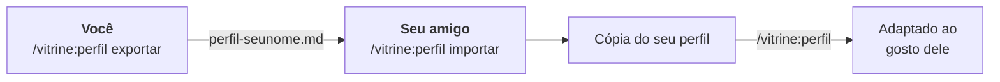

**Português** · [English](README.en.md)

# Vitrine

**Seu site é a vitrine. Ela precisa ter a sua cara.**

Uma skill para o **Claude Code** que cria sites, landing pages e portfólios com personalidade. Ela começa descobrindo o que torna você, ou o seu cliente, diferente, e usa isso no visual, no texto e nos detalhes.


<sub>Mesmo pedido, mesmo modelo de IA. À esquerda, sem a skill; à direita, com ela.</sub>

## O que ela tem de diferente

- **Cada site nasce de quem está por trás.** A skill procura o que só aquele negócio ou aquela pessoa tem (o saco de pão da padaria, a ordem de serviço da oficina, o caderno de esboços de um designer) e faz disso o conceito visual.
- **Diferente, mas reconhecível.** Foge do clichê do setor sem perder os sinais dele: clínica continua parecendo clínica.
- **Nada inventado.** Depoimento, preço, prêmio ou foto que o cliente não deu fica marcado `[[assim]]`, ou a skill diz exatamente qual foto tirar.
- **Confere antes de entregar.** Tira prints no computador e no celular, procura texto cortado, letra pequena e linha que some, e corrige.
- **Pronta para o dia a dia do freela.** Mensagem de briefing para o WhatsApp do cliente, 2 ou 3 conceitos em PDF para ele escolher e site em HTML puro, que roda em qualquer hospedagem.
- **Feita para negócio local.** Botão de WhatsApp, horários, endereço, Google e as regras de propaganda dos conselhos (CFO, CFM, OAB).
- **Ajuste com precisão.** Na página de aprovação, você toca num título, botão ou seção do print e escreve o que mudar ali. A skill sabe exatamente qual elemento mexer.
- **Aprende o seu gosto.** Você aprova ou reprova os sites numa página própria, e a skill guarda o que funciona para você nos próximos trabalhos.

## Instalação

No Claude Code, digite:

```
/plugin install vitrine --marketplace zjeanero/vitrine-skill
```

Feche e abra o Claude Code e digite **`/vitrine:inicio`**. Ele confere se falta algo no seu computador e mostra o passo a passo.

<details>
<summary><b>Primeira vez? O que precisa ter</b></summary>

- **Node 22 ou mais novo.** No terminal, digite `node --version`. Se não tiver, baixe a versão LTS em [nodejs.org](https://nodejs.org).
- **Chrome ou Edge.** O Windows já vem com o Edge.
</details>

<details>
<summary><b>Para profissionais</b></summary>

| Para | Comando |
|---|---|
| Instalar pelo terminal | `claude plugin install vitrine --marketplace zjeanero/vitrine-skill` |
| Instalar só num projeto | acrescente `--scope project` ou `--scope local` |
| Atualizar | `claude plugin update vitrine@vitrine-skill` |
| Desligar / remover | `claude plugin disable vitrine@vitrine-skill` / `claude plugin uninstall vitrine@vitrine-skill` |
| Instalar sem GitHub | a partir do pacote .zip (veja [Seu perfil e compartilhar](#seu-perfil-e-compartilhar)) |
| Claude Code antigo | `/plugin marketplace add zjeanero/vitrine-skill` e depois `/plugin install vitrine@vitrine-skill` |
</details>

<details>
<summary><b>Deu problema?</b></summary>

| Problema | Solução |
|---|---|
| `/vitrine:inicio` não aparece | Feche e abra o Claude Code |
| Erro com `--marketplace` | Rode `claude update` |
| Não encontrou o repositório | Confira se digitou `zjeanero/vitrine-skill` certinho |
| "node não é reconhecido" | Instale o Node LTS em [nodejs.org](https://nodejs.org) e reabra o terminal |
| "Chrome/Edge não encontrado" | Instale o Google Chrome |
</details>

## Como usar

| | Você digita | Você recebe |
|:-:|---|---|
| **0** | `/vitrine:perfil` *(uma vez)* | O Claude aprende o seu gosto, a partir de links ou prints de referência |
| **1** | `/vitrine:briefing Padaria do Sérgio` | Uma mensagem pronta para o WhatsApp do cliente, com perguntas e lista de fotos |
| **2** | Cole a resposta, ou `/vitrine:aproveitar <link>` | Tudo organizado: o que é fato e o que falta |
| **3** | `/vitrine:conceitos` | 2 ou 3 caminhos visuais (HTML + PDF) para o cliente escolher |
| **4** | `/vitrine:site` | O site pronto, conferido no computador e no celular |
| **5** | `/vitrine:avaliar` | Uma página para aprovar ou reprovar os sites e marcar no print o lugar exato de cada ajuste. A skill aprende o seu gosto com isso |
| **+** | `/vitrine:revisar <link>` | O diagnóstico de qualquer site: o que tem cara de IA e o que falta |

Os comandos são só atalhos: também funciona falando normalmente.

## Por que não só um prompt?

Um prompt direto já acerta o básico técnico. A skill garante o resto:

| | Prompt direto | Com a skill |
|---|---|---|
| **Ponto de partida** | O mais provável: título central, cards, gradiente | Os objetos e o jeito do negócio viram o conceito |
| **Tipografia** | Fontes da moda (a mesma em 2 de 3 testes) | Uma letra escolhida pelo negócio, entre fontes verificadas |
| **Conteúdo** | Inventa o que falta | Nunca inventa: marca `[[assim]]` |
| **Conferência** | Entrega sem olhar | Prints no computador e no celular, e correção antes de entregar |
| **Negócio local** | Genérico | WhatsApp, horários, Google, regras de conselhos (CFO, CFM, OAB) |
| **Para o cliente** | Só o site | Briefing para o WhatsApp e 2 ou 3 conceitos para ele escolher |
| **Seu gosto** | Do zero a cada conversa | Um perfil salvo com referências e stack, que aprende com cada site que você aprova |

<details>
<summary><b>Mais exemplos e como foi testado</b></summary>


Três negócios fictícios receberam o mesmo pedido, uma vez com a skill e outra sem. Nos critérios automáticos (WhatsApp, celular, SEO local, nada inventado), o placar foi 100% com a skill e 95% sem. A diferença maior apareceu no visual, nas fontes e no conteúdo inventado. Os testes estão em [`avaliacao/`](avaliacao/).
</details>

## Seu perfil e compartilhar

A skill é igual para todos. O seu gosto fica num **perfil**, em `~/.claude/landing-page/`, que as atualizações não apagam.

- **Criar ou mudar o perfil:** `/vitrine:perfil`
- **Mandar para um amigo:** `/vitrine:perfil exportar` gera um arquivo. Ele roda `/vitrine:perfil importar <arquivo>` e adapta ao gosto dele. A cópia dele não mexe na sua.
- **Mandar sem GitHub:** `pwsh ferramentas/empacotar.ps1 -ComPerfil -Nome <seu-nome>` gera um .zip com a skill e o perfil. Ele instala com `/plugin install vitrine --marketplace <pasta>/skill`.

<details>
<summary><b>Passo a passo detalhado</b></summary>



1. **Você** roda `/vitrine:perfil exportar`. Sai um arquivo só, como `perfil-jean.md`, sem o registro de clientes. Mande por WhatsApp, e-mail ou Drive.
2. **Ele** instala a skill e roda `/vitrine:perfil importar perfil-jean.md`. Dá para arrastar o arquivo para a janela em vez de digitar o caminho.
3. **Ele adapta falando normalmente:** `/vitrine:perfil eu uso Astro`, `/vitrine:perfil adiciona https://…`.

**Se ele já tiver um perfil,** o Claude pergunta antes de mexer: **juntar** (as suas referências entram junto com as dele), **substituir** (o perfil dele fica guardado em `antigo-<data>/`) ou **cancelar**.

**Pelo .zip:** ele descompacta numa pasta que não vá apagar e aponta para a pasta `skill` que veio dentro. O `LEIA-ME.txt` do pacote tem o passo a passo. A cada versão nova é preciso mandar outro .zip. Quem instalou pelo GitHub só roda `claude plugin update vitrine@vitrine-skill`.
</details>

## Perguntas rápidas

<details>
<summary><b>Preciso saber programar?</b></summary>

Não. Você conversa com o Claude, e ele entrega a pasta pronta. Saber HTML só ajuda nos ajustes finos.
</details>

<details>
<summary><b>Que tecnologia o site usa?</b></summary>

HTML, CSS e JavaScript puros (PHP quando precisa), que rodam em qualquer hospedagem. Se você usa outra stack (Astro, Next.js, WordPress…), diga no `/vitrine:perfil`.
</details>

<details>
<summary><b>Onde ficam os arquivos?</b></summary>

Cada cliente ganha uma pasta com `briefing.md`, `material/` (fotos do cliente), `conceitos/`, `site/` e `NOTAS.md` (pendências e lista de fotos).
</details>

<details>
<summary><b>A skill gera fotos?</b></summary>

Não, de propósito: foto inventada do negócio engana quem vai até lá. Ela usa as fotos reais do cliente com tratamento, desenhos feitos em código e, onde falta foto, deixa a descrição exata de qual foto tirar.
</details>

<details>
<summary><b>Quanto consome do meu plano?</b></summary>

Cerca de 650 tokens fixos por sessão e uns 7 mil quando a skill é usada. Um site completo, com revisão visual, fica na casa de 200 a 300 mil tokens.
</details>

<details>
<summary><b>Para quem mantém este repositório</b></summary>

```
.claude-plugin/marketplace.json     catálogo para instalar com um comando
plugins/vitrine/                    o plugin: commands/ (os /vitrine:*) e skills/landing-page/ (a skill)
perfis/modelo/                      perfil-modelo vazio
avaliacao/                          testes com e sem a skill
ferramentas/empacotar.ps1           gera o .zip para mandar sem GitHub
docs/img/                           imagens deste README
```

**Para lançar uma versão:**
1. Suba a `version` em `plugins/vitrine/.claude-plugin/plugin.json`.
2. Rode `claude plugin validate .`.
3. Faça o push e rode `claude plugin update vitrine@vitrine-skill`.
</details>

## Licença

[MIT](LICENSE): use, modifique e faça sites para seus clientes à vontade. Só mantenha o arquivo de licença junto.
